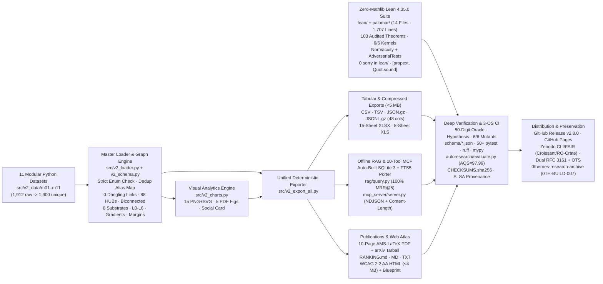

# System Architecture — Unsolved Problems Mega-Atlas (`V2.8.0`)

See also [`docs/architecture.md`](docs/architecture.md) and Architecture Decision Records in [`docs/adr/`](docs/adr/README.md).



## Directory Map

| Path | Role | License |
|---|---|---|
| `src/v2_schema.py` | Strict enum definitions (`8` Macro-Pillars, `28` Superdomains, `88` `CANONICAL_HUBS`, `P(...)` constructor) | Apache-2.0 |
| `src/v2_data/m01..m11.py` | 11 domain-specialized problem modules (`1,912` raw authored entries, incl. `m11` substrates/margins/adjacents blindspot closure) | CC-BY-4.0 |
| `src/v2_loader.py` | Strict deduplication with `dedup_alias_map` (`0` dangling links), HUB resolution, biconnected NetworkX analytics, 0thernes `CSS`, `Titan Index`, 8 Substrates, 7 Layers (`L0–L6`), Gradients, Margins, Spectrum & Margin Roles | Apache-2.0 |
| `src/v2_charts.py` | Generates 15 analytical figures (PNG + vector SVG = 30 files), 5 vector PDF paper figures, and the `1280×640` social preview card | Apache-2.0 |
| `src/v2_export_all.py` | Deterministic cross-OS exporter for LF CSV/TSV, deterministic `.json.gz`/`.jsonl.gz`, auto-built SQLite+FTS5 (11 tables), deterministic 15-sheet XLSX, 8-sheet XLS, MD, TXT, `RANKING.md`, WCAG 2.2 AA `<4 MB` HTML, and optional `build/` Directory PDF | Apache-2.0 |
| `lean/` & `palomar/` | Pure Lean 4.35.0 (zero Mathlib) proof library certifying **103 exact mathematical invariants** (`72` core + `12` NonVacuity + `10` AdversarialTests refutations + `9` Palomar comparator targets) across 14 files (`1,707` lines) and **6 independent kernels** | Apache-2.0 |
| `paper/` & `dist/` | 10-page Tectonic AMS-LaTeX white paper (`paper/main.tex`, `refs.bib`, 5 PDF figures) compiled to `dist/Donahue_2026_unsolved_problems_mega_atlas.pdf` + clean-room `dist/arxiv_submission.tar.gz` | CC-BY-4.0 |
| `blueprint/` | Interactive SVG Lean 4.35.0 dependency DAG deployed alongside the Web Atlas on GitHub Pages | CC-BY-4.0 |
| `reference/` | Independent 50-digit `Decimal` / `Fraction` reference oracle (`scoring_oracle.py`) with zero shared production code | Apache-2.0 |
| `schema/` | JSON Schema Draft 2020-12 formal contracts (`problem.schema.json` with 48 typed fields, `atlas.schema.json`) | Apache-2.0 |
| `rag/` | Zero-API offline Hybrid BM25 + Title-Bigram + PageRank + graph-hop retrieval CLI (`rag/query.py`, `100.0% MRR@5`, auto-builds SQLite on clean clones) | Apache-2.0 |
| `mcp_server/` | Zero-dependency dual-framed (NDJSON + `Content-Length:`) stdio JSON-RPC 2.0 server exposing **11 grounded research tools** (incl. `simulate_rubric_override`) | Apache-2.0 |
| `autoresearch/` | Karpathy-style autonomous research loop (`program.md`, immutable `evaluate.py`, empirical `results.tsv`, `whiteboard.md`, `OSS_STACK.md`) | Apache-2.0 |
| `research/runs/` | Three exact finite Track B computational pilots (`LOG-002_antihydra_pilot/`, `NT-005_collatz_parity_pilot/`, `COMB-001_ramsey_witness_pilot/`) with strict non-claim bounds | Apache-2.0 / CC-BY-4.0 |
| `tests/` | Automated `pytest` suite (`test_mega_atlas.py`, `test_properties_and_differential.py`, `test_external_mirrors.py`, `golden/top10_css_titan.json`) covering schema, Hypothesis, 50-digit oracle differential, metamorphic, golden, negative, 100% RAG, 11-tool MCP, 3 Track B probes, external registry & Left to Solve mirrors, rubric sensitivity, FAIR, Lean & SHA-256 | Apache-2.0 |
| `scripts/` | `audit_atlas.py`, `forensic_audit.py`, `run_mutation_audit.py`, `benchmark_atlas.py`, `build_paper.py`, `check_citations.py` (with Crossref retraction check), `check_readme_axioms.py`, `verify_lean_six_kernels.sh`, `stamp_timestamps.py`, `sync_external_registries.py`, `sync_lefttosolve.py`, `rubric_override_diff.py`, `generate_fair_metadata.py`, `generate_llms_full.py`, `publish_zenodo.py`, `Audit-Repo.ps1` | Apache-2.0 |
| `data/external/lefttosolve/` | Daily sidecar metadata mirror of all 25 Left to Solve programs (`programs/*.jsonl` `< 4 MB`, `snapshot.json`, `atlas_crosswalk.json`, `CHANGES.jsonl`, strict-CSP `index.html`, `MANIFEST.sha256`), published on GitHub Pages at `/external/lefttosolve/` (never mutates frozen 1,900-row data) | Upstream sources (carved out of CC-BY-4.0; see `THIRD_PARTY_NOTICES.md`) |
| `outputs/` | All `< 5 MB` tracked `v2.8.0` datasets, 15×2 charts, and WCAG 2.2 AA Interactive HTML (heavy `.sqlite`/`.json`/`.jsonl`/168p PDF regenerated deterministically & attached to GitHub Releases) | CC-BY-4.0 |
| `docs/` | `WHITE_PAPER.md`, `DATASHEET.md`, `FORENSIC_AUDIT_V2.3.md`, `PRESERVATION.md`, `METHODOLOGY.md`, `AI_DISCLOSURE.md`, `ACADEMIC_REVIEW.md`, `statement-fidelity.md`, `literature-search-log.md`, `lefttosolve-programs.md`, `registry-delta-latest.md`, `benchmarks.md`, `threat-model.md`, `operations.md`, `adr/`, `reviews/`, `media/` | CC-BY-4.0 |
| `.github/` | 3-OS + 6-kernel + Tectonic + SLSA CI (`ci.yml`), 2-job GitHub Pages (`pages.yml`), daily external registry sync (`daily-registry-sync.yml`), tag release bundler (`release.yml`), 10-class `labels.tsv`, and structured Issue templates (no PR template per R4) | Apache-2.0 |

## One-Command Reproduction

```bash
just setup && just reproduce && just test && just lean && just paper
# On Linux with bubblewrap (full 6-kernel replay):
just lean-kernels
```
