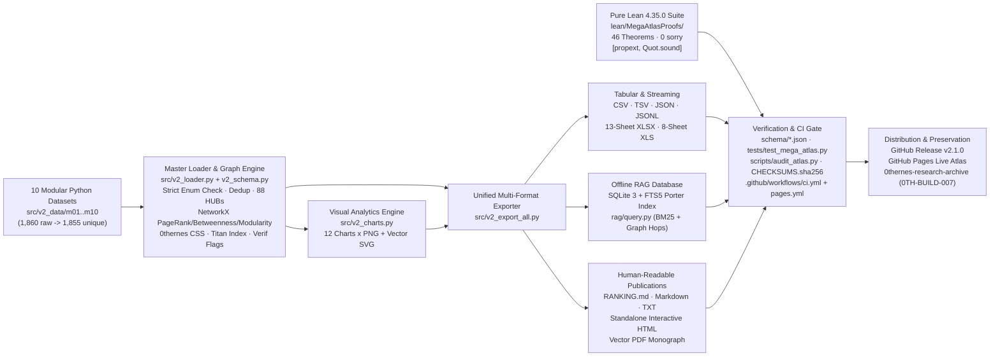

# System Architecture — Unsolved Problems Mega-Atlas (V2.1.0)



## Directory Map

| Path | Role | License |
|---|---|---|
| `src/v2_schema.py` | Strict enum definitions (`8` Macro-Pillars, `28` Superdomains, `88` `CANONICAL_HUBS`, `P(...)` constructor) | MIT |
| `src/v2_data/m01..m10.py` | 10 domain-specialized problem modules (`1,860` raw authored entries) | CC BY 4.0 |
| `src/v2_loader.py` | Deduplication, HUB resolution, NetworkX analytics, 0thernes `CSS`, `Titan Index`, `verification_flag`, cross-tab matrices | MIT |
| `src/v2_charts.py` | Generates 12 publication-grade analytical figures in both 220-DPI PNG and vector SVG | MIT |
| `src/v2_export_all.py` | Deterministic exporter for CSV, TSV, JSON, JSONL, SQLite+FTS5, XLSX, XLS, MD, TXT, `RANKING.md`, Interactive HTML, and Chrome-headless Vector PDF | MIT |
| `lean/` | Pure Lean 4.35.0 (zero Mathlib) proof library certifying 46 exact mathematical invariants of scoring, quadrants, eras, taxonomy, and finite graphs | MIT |
| `schema/` | JSON Schema Draft 2020-12 formal contracts (`problem.schema.json`, `atlas.schema.json`) | MIT |
| `rag/` | Zero-API offline BM25 + graph-hop retrieval CLI (`rag/query.py`) over `MegaAtlas_Unsolved_Problems_V2.sqlite` | MIT |
| `tests/` | Automated `pytest` verification suite (`tests/test_mega_atlas.py`) covering schema, math invariants, graph handshaking, format parity, RAG, ORCID, Lean hygiene, and SHA-256 | MIT |
| `scripts/` | `audit_atlas.py` (cryptographic + structural + Lean auditor) and `sync_and_checksum.py` | MIT |
| `outputs/` | All frozen V2.1.0 datasets, SQLite DB, 12×2 charts, Interactive HTML, Print HTML, and Vector PDF (byte-exact tracked via `.gitattributes` + `CHECKSUMS.sha256`) | CC BY 4.0 |
| `docs/` | `WHITE_PAPER.md`, `METHODOLOGY.md`, `AI_DISCLOSURE.md`, `ACADEMIC_REVIEW.md` | CC BY 4.0 |
| `.github/` | Multi-job CI (`ci.yml`), automated GitHub Pages deployment (`pages.yml`), structured Issue & PR templates | MIT |

## Reproducibility Guarantee

From a clean clone with Python 3.11+ and Lean 4.35.0 (`elan`):
```bash
pip install -r requirements.txt
python src/v2_charts.py
python src/v2_export_all.py
cd lean && lake build && cd ..
pytest -v
python scripts/audit_atlas.py --check-lean
```
On Windows PowerShell, run `.\build.ps1`; on Unix/macOS, run `make all`.
