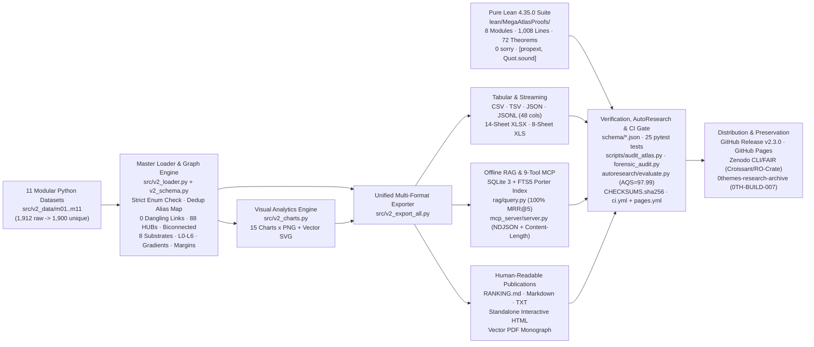

# System Architecture — Unsolved Problems Mega-Atlas (`V2.3.0`)



## Directory Map

| Path | Role | License |
|---|---|---|
| `src/v2_schema.py` | Strict enum definitions (`8` Macro-Pillars, `28` Superdomains, `88` `CANONICAL_HUBS`, `P(...)` constructor) | MIT |
| `src/v2_data/m01..m11.py` | 11 domain-specialized problem modules (`1,912` raw authored entries, incl. `m11` substrates/margins/adjacents blindspot closure) | CC BY 4.0 |
| `src/v2_loader.py` | Strict deduplication with `dedup_alias_map` (`0` dangling links), HUB resolution, biconnected NetworkX analytics, 0thernes `CSS`, `Titan Index`, 8 Substrates, 7 Layers (`L0–L6`), Gradients, Margins, Spectrum & Margin Roles | MIT |
| `src/v2_charts.py` | Generates 15 publication-grade analytical figures in both 220-DPI PNG and vector SVG (`30` files) | MIT |
| `src/v2_export_all.py` | Deterministic exporter for CSV, TSV, JSON, JSONL, SQLite+FTS5 (10 tables), 14-sheet XLSX, 8-sheet XLS, MD, TXT, `RANKING.md`, Interactive HTML, and Chrome-headless Vector PDF | MIT |
| `lean/` | Pure Lean 4.35.0 (zero Mathlib) proof library certifying **72 exact mathematical invariants** across 8 modules (`1,008` lines) | MIT |
| `schema/` | JSON Schema Draft 2020-12 formal contracts (`problem.schema.json` with 48 typed fields, `atlas.schema.json`) | MIT |
| `rag/` | Zero-API offline Hybrid BM25 + PageRank + graph-hop retrieval CLI (`rag/query.py`, `100.0% MRR@5`) | MIT |
| `mcp_server/` | Zero-dependency dual-framed (NDJSON + `Content-Length:`) stdio JSON-RPC 2.0 server exposing **9 grounded research tools** | MIT |
| `autoresearch/` | Karpathy-style autonomous research loop (`program.md`, immutable `evaluate.py`, empirical `results.tsv`, `whiteboard.md`, `OSS_STACK.md`) | MIT |
| `research/runs/` | Track B open-problem empirical exploration pilots (e.g., `LOG-002_antihydra_pilot/` probing `BB(6)` Antihydra with strict non-claim bounds) | MIT / CC BY 4.0 |
| `tests/` | Automated **25-test `pytest` suite** (`tests/test_mega_atlas.py`) covering schema, math/layer invariants, biconnectivity, format parity, 100% RAG, dual-framed 9-tool MCP, FAIR, Zenodo dry-run, Track B, ORCID, 72 Lean thms & SHA-256 | MIT |
| `scripts/` | `audit_atlas.py`, `forensic_audit.py`, `generate_fair_metadata.py`, `publish_zenodo.py`, and `sync_and_checksum.py` | MIT |
| `outputs/` | All frozen V2.3.0 datasets, SQLite DB, 15×2 charts, Interactive HTML, Print HTML, and Vector PDF (tracked via `.gitattributes` + `CHECKSUMS.sha256`) | CC BY 4.0 |
| `docs/` | `WHITE_PAPER.md`, `DATASHEET.md`, `FORENSIC_AUDIT_V2.3.md`, `PRESERVATION.md`, `METHODOLOGY.md`, `AI_DISCLOSURE.md`, `ACADEMIC_REVIEW.md` | CC BY 4.0 |
| `.github/` | Multi-job CI (`ci.yml`), automated GitHub Pages deployment (`pages.yml`), structured Issue & PR templates | MIT |

## Reproducibility Guarantee

From a clean clone with Python 3.11+ and Lean 4.35.0 (`elan`):
```bash
pip install -r requirements.txt
python src/v2_charts.py
python src/v2_export_all.py
python scripts/generate_fair_metadata.py
cd lean && lake build && cd ..
python scripts/audit_atlas.py --check-lean
python scripts/forensic_audit.py
python scripts/publish_zenodo.py --dry-run
python autoresearch/evaluate.py --verify-gates
pytest -v
```
On Windows PowerShell, run `.\build.ps1`; on Unix/macOS, run `make all`.
