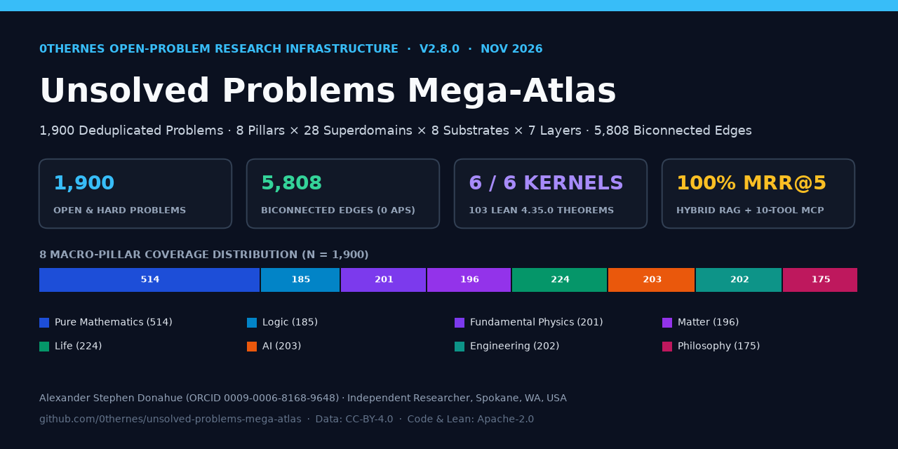

# Unsolved Problems Mega-Atlas (`v2.8.0`)

[](https://github.com/0thernes/unsolved-problems-mega-atlas/actions/workflows/ci.yml)
[](https://0thernes.github.io/unsolved-problems-mega-atlas/)
[](lean/README.md)
[](LICENSE)
[](LICENSE-CODE)
[](https://orcid.org/0009-0006-8168-9648)



> **Status:** `active` · **Version:** `2.8.0` (November 26, 2026) · **Master Archive Entry:** `0TH-BUILD-007`
> **Author / Curator:** Alexander Stephen Donahue (`Independent Researcher, Spokane, WA, USA` · ORCID [`0009-0006-8168-9648`](https://orcid.org/0009-0006-8168-9648))
> **Dual License:** Dataset, Charts, White Paper & Prose [`CC-BY-4.0`](LICENSE) · Code, Lean 4.35.0 Proofs, Tests & Tools [`Apache-2.0`](LICENSE-CODE)
> **Supported locales:** English (`en-US`, UTF-8)

An open dataset and software suite that catalogues **`1,900` deduplicated unsolved, open and hard problems** across **8 Macro-Pillars × 28 Superdomains × 8 Physical/Formal Substrates × 7 Abstraction Layers (`L0–L6`) × 1,752 subdomains**, linked in a **`5,808`-edge knowledge graph** that the Python audit (NetworkX) finds biconnected (`0` articulation points, `0` bridges, `0` dangling links, `35.7%` cross-superdomain, `18.7%` cross-pillar). It comes with:

- **103 audited Lean 4.35.0 theorems without Mathlib** about the atlas software model: `72` in the core modules, `12` NonVacuity witnesses, `10` `AdversarialTests` refutations of weakened variants and `9` Palomar contract theorems (`5` private helper lemmas in `GraphInvariants` are not in the audit list). They are kernel-checked by Lean (`lake build`, `leanchecker --fresh`, `leanchecker-paranoid`); the `9` comparator targets in `lean/comparator.json` were also accepted by six kernel checks in Ubuntu CI (Lean default and paranoid modes, `lean4lean`, `nanoda`, `con-leche`, `con-ron`; five distinct implementations), and a deliberately false theorem is rejected. Each audited theorem depends on at most `propext` and `Quot.sound` (`#print axioms`); this per-theorem result does not cover the whole-environment `lake check --paranoid` output, which also lists `Classical.choice`. Several counted theorems are literal arithmetic identities or restate a hypothesis.
- **10-page AMS-LaTeX white paper** ([`dist/Donahue_2026_unsolved_problems_mega_atlas.pdf`](dist/Donahue_2026_unsolved_problems_mega_atlas.pdf); `0` overfull hboxes; `scripts/check_citations.py` reports `12/12` citations reachable and `0` Crossref retractions), a deterministic source tarball [`dist/arxiv_submission.tar.gz`](dist/arxiv_submission.tar.gz), and timestamps of `CHECKSUMS.sha256` from DigiCert RFC 3161 ([`CHECKSUMS.sha256.tsr`](CHECKSUMS.sha256.tsr)) and OpenTimestamps ([`CHECKSUMS.sha256.ots`](CHECKSUMS.sha256.ots)).
- **Live Interactive Web Atlas, Lean Blueprint & Daily Program Mirror:** [Web Atlas](https://0thernes.github.io/unsolved-problems-mega-atlas/), [Lean 4.35.0 Proof Blueprint DAG](https://0thernes.github.io/unsolved-problems-mega-atlas/blueprint/), and [Daily Left to Solve Program Mirror](https://0thernes.github.io/unsolved-problems-mega-atlas/external/lefttosolve/) (strict CSP, WCAG 2.2 AA accessible, `< 4 MB`).
- **Offline SQLite FTS5 hybrid search** (`100.0%` MRR@5, `25/25` top-1 on the benchmark queries) and an **11-tool MCP server** with no external SDK (`mcp_server/server.py`, `1 MiB` frame cap, including `simulate_rubric_override`), a **registry delta checker** (`scripts/sync_external_registries.py`), a fixed AutoResearch evaluation harness modelled on Karpathy's `autoresearch` (`AQS = 97.99`), and **3 finite Track B probes** (`LOG-002` Antihydra, `NT-005` Collatz, `COMB-001` Ramsey witnesses) whose parent problems stay open.
- **Python test ladder:** 50-digit `Decimal`/`Fraction` reference oracle (`reference/scoring_oracle.py`), 1,000-example Hypothesis property suite, 2,000-case differential tests, metamorphic and golden snapshots, and a mutation audit that kills all `6` planted mutants.

---

## Honest Verification Boundary (Read First)

1. **Zero (`0 / 1,900`) Mega-Atlas open problems are claimed solved or retired.** The 103 Lean 4.35.0 theorems concern the atlas *software model* only: bounds of the CSS, Titan, leverage and AQS formulas for in-range inputs, monotonicity of CSS, Titan and leverage, quadrant and era maps, sizes of the taxonomy lists, a generic handshaking lemma for list multigraphs, a dedup bound, the AutoResearch keep/discard rule, gradient and margin bounds, non-vacuity witnesses and refutations of weakened variants. No Lean statement refers to the 1,900-row data, its 5,808-edge graph or biconnectivity; those properties, and the agreement between the Lean and Python formulas, are checked by Python tests.
2. **Author's companion archive entries (`0thernes-research-archive`):** The authoritative list of the author's results is the archive ledger [`RESULTS.md`](https://github.com/0thernes/0thernes-research-archive/blob/main/RESULTS.md). Its section A, open questions stated by other authors and answered, holds three results: R1 (Banić–Elezović Conjecture 7.7, `0TH-2026-006`) and R44, R45 (questions of Muller–Saniga and of Jonah, `0TH-2026-009`). The other results are new theorems, bounded cases, known results formalized, or invariant suites for software models. The `17` companion rows in `src/v2_loader.py` and MCP tool `list_author_frontier_contributions` map a selection of entries to atlas IDs and cite their ledger numbers; `paper/main.tex` Section 6 and `RANKING.md` still carry older wording, corrected in [`ERRATA.md`](ERRATA.md). All entries are self-published, not peer reviewed, and every Mega-Atlas parent problem stays **OPEN**.
3. **Fall/November 2026 AI proof claims:** All `12` targets (`NT-001` Riemann Hypothesis, `NT-002` GRH, `ANL-001` 3D Navier–Stokes, etc.) stay flagged `ai-claim-under-audit-nov2026` and unretired (checked with `just sync-registries`; see [`docs/registry-delta-2026-11-26.md`](docs/registry-delta-2026-11-26.md)). On 21 November 2026 the Lean FRO and the Mathlib Initiative certified the statement and proof of the Riemann Hypothesis in Levent Alpöge's Lean library (<https://leanprover-community.github.io/blog/posts/riemann-hypothesis/>); M. Rubinstein reports independent Lean verification checks of the RH/GRH proofs (<https://www.math.uwaterloo.ca/~mrubinst/alpoge_claude_grh/>). `NT-001` and `NT-002` stay unretired pending a human-readable paper and community review; see [`ERRATA.md`](ERRATA.md) section A.
4. **Editorial Rubric Disclosure & Sensitivity Simulator:** Quantitative ratings (`difficulty_score`, `tractability_2050`, `civilizational_impact`, `interdisciplinarity_index`) are disclosed AI-assisted editorial estimates — not peer-reviewed consensus measurements. Custom weights or per-problem overrides can be tested with `just rubric-diff` (`scripts/rubric_override_diff.py`) or MCP tool `simulate_rubric_override`.

---

## Reproducing the Lean 4.35.0 Audit

Reproduce the axiom audit of the 103 theorems locally:

```bash
cd lean
lake build
lake env lean MegaAtlasProofs/VerifyAxioms.lean
```

Verbatim Palomar headline theorem audit from [`results/lean_axioms.txt`](results/lean_axioms.txt) (drift-checked in CI via `scripts/check_readme_axioms.py`):

<!-- LEAN_AXIOMS_START -->
```text
'MegaAtlasProofs.Palomar.m1_scoring_invariants' depends on axioms: [propext, Quot.sound]
'MegaAtlasProofs.Palomar.m2_quadrant_and_era_invariants' depends on axioms: [propext, Quot.sound]
'MegaAtlasProofs.Palomar.m3_taxonomy_invariants' depends on axioms: [propext]
'MegaAtlasProofs.Palomar.m4_graph_and_dedup_invariants' depends on axioms: [propext, Quot.sound]
'MegaAtlasProofs.Palomar.m5_autoresearch_ratchet_invariants' depends on axioms: [propext, Quot.sound]
'MegaAtlasProofs.Palomar.m6_layer_gradient_margin_invariants' depends on axioms: [propext, Quot.sound]
'MegaAtlasProofs.Palomar.m7_nonvacuity_certificate' depends on axioms: [propext, Quot.sound]
'MegaAtlasProofs.Palomar.m8_adversarial_refutations' depends on axioms: [propext, Quot.sound]
'MegaAtlasProofs.Palomar.prove_all_mega_atlas_invariants' depends on axioms: [propext, Quot.sound]
```
<!-- LEAN_AXIOMS_END -->

On Linux with `bubblewrap`, run the kernel checks used in CI (Lean default and paranoid modes, `lean4lean`, `nanoda`, `con-leche`, `con-ron`; five distinct implementations) with the same script CI uses. `nanoda`, `con-leche` and `con-ron` check an export of three headline theorems and their dependency closure; the Palomar comparator checks the 9 targets in `lean/comparator.json`:

```bash
bash scripts/verify_lean_six_kernels.sh   # or: just lean-kernels
```

---

## Usage

### 1. Quickstart Setup & Demo (Zero API Keys, 100% Offline)

```bash
git clone https://github.com/0thernes/unsolved-problems-mega-atlas.git
cd unsolved-problems-mega-atlas
python -m venv .venv
# Windows: .venv\Scripts\activate  |  Linux/macOS: source .venv/bin/activate
pip install -e ".[dev]"
python examples/quickstart_demo.py
```

### 2. Offline Hybrid RAG Search & Side-by-Side Comparison

The SQLite FTS5 index auto-builds deterministically in `< 1 s` on first run on a clean clone:

```bash
python rag/query.py "turbulence climate sensitivity" --top 8 --hops 1
python rag/query.py --problem NT-001 --hops 1
python rag/query.py --compare NT-001 CS-001
python rag/query.py --flag ai-claim-under-audit-nov2026 --top 15
```

### 3. Model Context Protocol (MCP) 11-Tool Stdio Server

Connect Claude Code, Antigravity, Cursor, or Gemini CLI directly (zero external MCP SDK required):

```json
{
  "mcpServers": {
    "unsolved-problems-mega-atlas": {
      "command": "python",
      "args": ["mcp_server/server.py"]
    }
  }
}
```

### 4. Full Deterministic Rebuild & Verification (`justfile`)

```bash
just reproduce     # Rebuild exports + pytest + 103-theorem Lean axiom audit + AMS-LaTeX paper + SHA-256
just lean-kernels  # Kernel checks under bubblewrap on Linux (lean, leanchecker-paranoid, lean4lean, nanoda, con-leche, con-ron)
just mutate        # 6-mutant semantic mutation testing
just bench         # 10-iteration warmed benchmark harness -> docs/benchmarks.md
just audit           # Python biconnectivity audit, Zenodo dry-run & AutoResearch gates
just sync-registries # Live advisory delta check against Clay CMI, erdosproblems.com & ProofAtlas
just sync-lefttosolve # Mirror all Left to Solve program lists (lefttosolve.com/programs) + verify
just rubric-diff     # Sensitivity diff (Spearman rho, Kendall tau, Top-25 Jaccard & rank movers)
```

### 5. Daily External Registry Mirrors

`.github/workflows/daily-registry-sync.yml` runs every day at 07:23 UTC (and on demand). It mirrors every program list on [Left to Solve](https://lefttosolve.com/programs) (Erdős problems, OEIS conjectures, Wikipedia's lists, Millennium Prize, Hilbert, Kourovka Notebook, Green's 100, MathOverflow, Open Problem Garden and the rest) through the site's public JSON API, polls the Clay, erdosproblems.com and ProofAtlas registries (`docs/registry-delta-latest.md`, preserving the frozen `v2.8.0` baseline `docs/registry-delta-2026-11-26.md`), verifies the result, commits it to `main` and redeploys GitHub Pages. The crawl fails closed: if any program count disagrees with the API's own total, nothing is written.

- **Browsable live dashboard:** [https://0thernes.github.io/unsolved-problems-mega-atlas/external/lefttosolve/](https://0thernes.github.io/unsolved-problems-mega-atlas/external/lefttosolve/) (zero-CDN, strict CSP, WCAG 2.2 AA).
- **Files:** Summary table [`docs/lefttosolve-programs.md`](docs/lefttosolve-programs.md); Clay/Erdős/ProofAtlas daily delta [`docs/registry-delta-latest.md`](docs/registry-delta-latest.md); sidecar data in `data/external/lefttosolve/` (per-program JSONL `< 4 MB`, `snapshot.json`, `index.html`, `atlas_crosswalk.json`, append-only `CHANGES.jsonl`, `MANIFEST.sha256`); latest delta `results/lefttosolve_delta.json`.
- **Honest scope & licensing:** The mirror keeps metadata and links only (no statement excerpts) and is a sidecar: it never edits the frozen 1,900-problem dataset or retires an Atlas problem. `atlas_crosswalk.json` lists automatic exact normalised-title candidates (with advisory `kind` and `solved` flags; not curated identifications). `Solved (by kind)` and `Lean-stated` flags are Left to Solve's own (mostly `known`/`warmup` targets) and are not re-verified here. Third-party titles under `data/external/lefttosolve/` retain their upstream sources' licences (`Apache-2.0` / `CC BY-SA 4.0`) and are excluded from this repository's `CC-BY-4.0` data licence (see [`THIRD_PARTY_NOTICES.md`](THIRD_PARTY_NOTICES.md)).

---

## Key Artifacts & Exports

| Artifact | Location | Size | Notes |
|---|---|---|---|
| **10-Page AMS-LaTeX White Paper PDF** | [`dist/Donahue_2026_unsolved_problems_mega_atlas.pdf`](dist/Donahue_2026_unsolved_problems_mega_atlas.pdf) | `0.68 MB` | Tectonic `amsart`, `0` overfull hboxes, `12/12` live citations (`0` retractions) |
| **Clean-Room arXiv Source Tarball** | [`dist/arxiv_submission.tar.gz`](dist/arxiv_submission.tar.gz) | `0.50 MB` | Deterministic (`mtime=0`), verified clean-room compile |
| **Interactive Web Atlas (WCAG 2.2 AA)** | [`outputs/MegaAtlas_Interactive_Dashboard_V2.html`](outputs/MegaAtlas_Interactive_Dashboard_V2.html) | `3.80 MB` | Live at [GitHub Pages](https://0thernes.github.io/unsolved-problems-mega-atlas/) |
| **Interactive Lean 4.35.0 Blueprint** | [`blueprint/index.html`](blueprint/index.html) | `14 KB` | SVG DAG linking all 103 audited theorems |
| **Tabular & Compressed JSON Exports** | `outputs/*.csv`, `*.tsv`, `*.json.gz`, `*.jsonl.gz`, `*.xlsx` (15 sheets), `*.xls` | `< 5 MB` each | 100% JSON Schema Draft 2020-12 valid; full uncompressed `.sqlite`/`.json`/168p PDF on [GitHub Releases](https://github.com/0thernes/unsolved-problems-mega-atlas/releases) |
| **15 Analytical Figures (PNG + SVG)** | `outputs/charts/01..15.{png,svg}` + `paper/figures/*.pdf` | `35` vector/raster files | Colorblind-safe 8-pillar palette |
| **FAIR Metadata, Checksums & RFC 3161 TSA** | `croissant.json`, `ro-crate-metadata.json`, `.zenodo.json`, `CHECKSUMS.sha256`, `CHECKSUMS.sha256.tsr`, `data/MANIFEST.sha256` | Tracked | SHA-256 manifests; `CHECKSUMS.sha256` is timestamped (DigiCert RFC 3161, OpenTimestamps) |
| **Falsifiable Claims & Hardening Logs** | [`CLAIMS.md`](CLAIMS.md), [`VERIFICATION.md`](VERIFICATION.md), [`docs/statement-fidelity.md`](docs/statement-fidelity.md), [`docs/literature-search-log.md`](docs/literature-search-log.md), [`HARDENING_LOG.md`](HARDENING_LOG.md), [`ERRATA.md`](ERRATA.md) | Tracked | Internal review logs (not external review); corrections from the [2026-11-26 statement audit](https://github.com/0thernes/0thernes-research-archive/blob/main/docs/reviews/2026-11-26-statement-audit.md) are in `ERRATA.md` |

---

## Limitations

See [`LIMITATIONS.md`](LIMITATIONS.md) for the complete analysis and Literal-vs-Metaphor table. Key boundaries:
- Quantitative rubric inputs (`difficulty`, `tractability_2050`, `impact`, `interdisciplinarity`) are solo AI-assisted editorial estimates, not peer-reviewed measurements.
- Pure Mathematics has denser historical registries than applied engineering/humanities (`952` of `1,900` records are flagged `ai-assisted-editorial-synthesis`).
- Lean 4.35.0 checks integer and list invariants of the scoring software over bounded inputs, not the atlas data; IEEE-754 `log1p` terms are checked differentially against the 50-digit `Decimal` reference oracle (`reference/scoring_oracle.py`).
- Neither this dataset nor the companion white paper has undergone external journal peer review.

---

## Citation & Preservation

See [`CITATION.cff`](CITATION.cff) and [`CITATION.bib`](CITATION.bib):

```bibtex
@misc{donahue2026megaatlas,
  author  = {Donahue, Alexander Stephen},
  title   = {Unsolved Problems Mega-Atlas (V2.8.0): A Multi-Layer Taxonomy, Biconnected Knowledge Graph, Six-Kernel Lean 4.35.0 Formal Invariant Suite, and Deterministic Research Infrastructure Across 1,900 Open Problems},
  year    = {2026},
  month   = nov,
  version = {2.8.0},
  url     = {https://github.com/0thernes/unsolved-problems-mega-atlas},
  note    = {ORCID: 0009-0006-8168-9648. Master Archive ID: 0TH-BUILD-007.}
}
```
