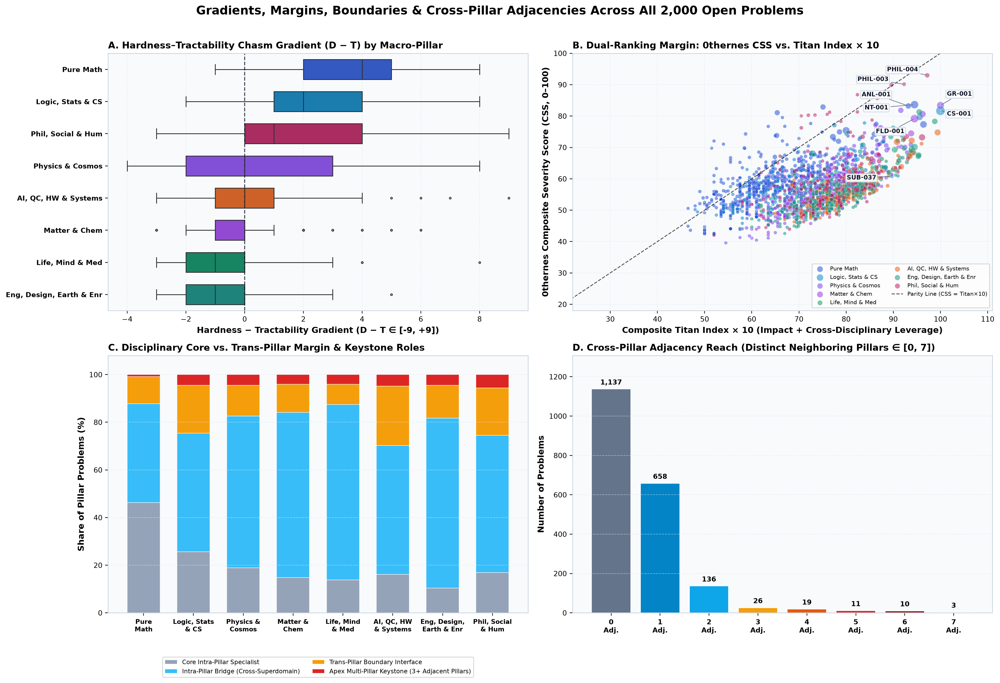

# Unsolved Problems Mega-Atlas (`v2.3.1`)

[](https://github.com/0thernes/unsolved-problems-mega-atlas/actions/workflows/ci.yml)
[](https://0thernes.github.io/unsolved-problems-mega-atlas/)
[](lean/MegaAtlasProofs/VerifyAxioms.lean)
[](https://orcid.org/0009-0006-8168-9648)
[](croissant.json)
[](NOTICE)
[](https://www.repostatus.org/#active)

> **1,900 rigorously deduplicated unsolved, open, and hard problems across ALL 8 Macro-Pillars × 28 Superdomains × 8 Physical/Formal Substrates × 7 Abstraction Layers (`L0–L6`)** — wired into a **biconnected 5,808-edge knowledge graph (`0` articulation points, `0` bridges, `0` dangling links)**, ranked by the **0thernes Composite Severity Score (`CSS`)**, **Composite Titan Index**, **Hardness–Tractability Gradient (`D − T`)**, **Dual-Ranking Margin**, and **Epistemic Spectrum**, paired with a **live November 20, 2026 AI Proof-Claim Verification Audit**, an **offline Hybrid BM25+PageRank RAG CLI (`100.0% MRR@5`, `25/25` top-1)**, a **dual-framed 9-tool MCP stdio server**, a **Karpathy-style AutoResearch harness (`AQS = 97.99` + Track B Antihydra `BB(6)` pilot)**, **FAIR Croissant 1.0 / RO-Crate 1.1 / Zenodo CLI metadata**, **15 publication-grade charts**, **14-sheet XLSX + 12 export formats**, and **72 Pure Lean 4.35.0 machine-checked formal invariants**.

- **Live Interactive Web Atlas:** [https://0thernes.github.io/unsolved-problems-mega-atlas/](https://0thernes.github.io/unsolved-problems-mega-atlas/) *(also serves [`llms.txt`](https://0thernes.github.io/unsolved-problems-mega-atlas/llms.txt), [`croissant.json`](https://0thernes.github.io/unsolved-problems-mega-atlas/croissant.json) & [`ro-crate-metadata.json`](https://0thernes.github.io/unsolved-problems-mega-atlas/ro-crate-metadata.json))*
- **Author / Curator (Human-in-the-Loop):** **Alexander Stephen Donahue** (`Independent Researcher`, Spokane, WA, USA · ORCID [`0009-0006-8168-9648`](https://orcid.org/0009-0006-8168-9648) · [0thernes.art](https://0thernes.art))
- **Master Research Archive Entry:** `0TH-BUILD-007` in [`0thernes/0thernes-research-archive`](https://github.com/0thernes/0thernes-research-archive) · **Solved-Problem Cross-Reference Audit:** [`docs/0THERNES_SOLVED_AUDIT_2026-11-25.md`](docs/0THERNES_SOLVED_AUDIT_2026-11-25.md) (`0/1,900` grand problems retired)
- **Companion Deep-Dive Math Atlas:** [`0thernes/unsolved-mathematics`](https://github.com/0thernes/unsolved-mathematics) *(shares the exact 0thernes `CSS` ranking standard)*
- **Forensic Audit & Preservation Dossiers:** [`docs/FORENSIC_AUDIT_V2.3.md`](docs/FORENSIC_AUDIT_V2.3.md) · [`docs/PRESERVATION.md`](docs/PRESERVATION.md)

---

## Epistemic Honesty & Verification Boundary (Read First)

> **Solo Human + Disclosed AI-Assisted Research Infrastructure:** This atlas is architected, directed, audited, and published by solo researcher **Alexander Stephen Donahue** with disclosed frontier AI assistance (see [`AUTHORS.md`](AUTHORS.md), [`docs/AI_DISCLOSURE.md`](docs/AI_DISCLOSURE.md), and [`docs/DATASHEET.md`](docs/DATASHEET.md)).
> - **What IS machine-verified:** All **72 Pure Lean 4.35.0 theorems** (`lean/MegaAtlasProofs/`, 8 modules, 1,008 lines, zero Mathlib, zero `sorry`, zero `native_decide`, zero `Classical.choice`, axioms strictly within `[propext, Quot.sound]` or empty) certifying exact scoring, quadrant, era, taxonomy, finite graph handshaking, pairwise delta antisymmetry, Karpathy AutoResearch anti-gaming keep/discard gates, and multi-layer substrate/gradient/margin invariants; JSON Schema Draft 2020-12 compliance across all `1,900 × 48` fields; 25-test `pytest` suite (including dual-framed 9-tool MCP stdio JSON-RPC & FAIR SHA-256 parity); biconnected graph topology (`0` articulation points, `0` bridges, `0` dangling links); and byte-exact SHA-256 digests (`CHECKSUMS.sha256`).
> - **What is NOT claimed:** This repository makes **zero claim to solve any open problem** (including Track B's finite Antihydra `BB(6)` probe in `research/runs/LOG-002_antihydra_pilot/`). Quantitative rubric scores (`difficulty`, `tractability_2050`, `impact`, `interdisciplinarity`, `CSS`, `Titan Index`, gradients, spectrum) are **transparent, falsifiable editorial estimates** — not peer-reviewed measurements. Every record carries an explicit `verification_flag`, and **all 12 Fall/Nov 2026 AI proof claims remain officially unretired** pending independent fidelity auditing and peer consensus.

---

## November 20, 2026 AI Proof-Claim Verification Advisory

Active mathematical registries already track well over 1,100–2,000+ open problems (`ProofAtlas.ai`: 1,100+ eligible / 243 open in Top-500; `erdosproblems.com`: ~1,221 tracked / ~630+ open; Kourovka: >1,000; Kirby: >360). Fall–November 2026 saw dramatic AI proof claims—including OpenAI's Sept 8 **3D Navier–Stokes** blowup claim (`ANL-001`), OpenAI's Oct 6 **722-manuscript bulk release** across 372 topics, and the Nov 20 **Levent Alpöge / Claude multi-million-line Lean 4 Riemann Hypothesis & GRH archive** (`NT-001`, `NT-002`) alongside Stanford's **Alessandro Masullo** human draft. Because Lean kernel compilation checks logical deduction *rather than formalization statement fidelity or community consensus*, **all 12 AI-claimed problems are strictly retained as OPEN under `verification_flag = "ai-claim-under-audit-nov2026"`**.

---

## Key Metrics & Eight Macro-Pillars (`N = 1,900`)

| Macro-Pillar | Problems | Share | Superdomains | Mean CSS (0–100) | Mean Titan (0–10) | Mean Diff | Mean Tract (2050) | Mean Impact | Nov 2026 AI Claims |
|---|---:|---:|---:|---:|---:|---:|---:|---:|---:|
| **Pure Mathematics** | 514 | 27.1% | 5 | 59.90 | 6.53 | 8.87 | 4.96 | 5.44 | 9 |
| **Life, Mind & Medicine** | 224 | 11.8% | 3 | 55.97 | 7.81 | 7.58 | 8.33 | 8.55 | 0 |
| **AI, Quantum Tech, Hardware & Systems** | 203 | 10.7% | 4 | 55.54 | 7.94 | 7.99 | 7.96 | 8.60 | 0 |
| **Engineering, Design, Earth & Energy** | 202 | 10.6% | 4 | 54.64 | 7.68 | 7.39 | 8.47 | 8.38 | 0 |
| **Fundamental Physics & Cosmos** | 201 | 10.6% | 3 | 56.47 | 7.40 | 8.11 | 7.18 | 7.33 | 1 |
| **Matter, Materials & Chemistry** | 196 | 10.3% | 3 | 55.46 | 7.51 | 7.79 | 8.06 | 7.82 | 0 |
| **Logic, Statistics & Computing** | 185 | 9.7% | 3 | 57.27 | 7.09 | 8.48 | 6.31 | 6.48 | 2 |
| **Philosophy, Social & Humanities** | 175 | 9.2% | 3 | 59.90 | 7.71 | 7.75 | 5.77 | 7.83 | 0 |
| **Unified Mega-Atlas Total / Mean** | **1,900** | **100.0%** | **28** | **57.33** | **7.31** | **8.13** | **6.81** | **7.22** | **12** |

- **Biconnected Connectome:** **5,808 undirected coupling edges** · **1 single connected component** (`1,900/1,900`) · **`0` articulation points** · **`0` bridge edges** · **`0` unresolved raw links** · **35.7%** cross-superdomain (`2,076`) · **18.7%** cross-pillar (`1,084`) · **14** modularity communities · average degree `6.11`.
- **Multi-Layer Topography (`48` Typed Columns):** **8 Substrates** × **7 Abstraction Layers (`L0–L6`)** · Mean Hardness–Tractability Gradient `D − T = +1.32` · Mean CSS−Titan×10 Margin `-15.76` · Mean Bridge Ratio `0.131` · Mean Adjacent Pillars `0.61` · Margin Roles: `Intra-Pillar Bridge` (`1,108`), `Core Specialist` (`485`), `Trans-Pillar Boundary Interface` (`239`), `Apex Multi-Pillar Keystone` (`68`, incl. `3` universal 7-pillar super-connectors).
- **Epistemic Flags:** `ai-assisted-editorial-synthesis` (`952`) · `primary-registry-indexed` (`925`) · `ai-claim-under-audit-nov2026` (`12`) · `disputed-human-claim` (`11`).
- **Top Keystone Domino Hubs:** `FLD-001` Fluid Turbulence (`deg=73`, `51` XP) · `CS-001` P vs. NP (`deg=67`, `42` XP) · `GR-001` Quantum Gravity (`deg=57`, `24` XP) · `GEO-002` Climate Sensitivity (`deg=53`, `31` XP) · `SYS-001` Nonlinear Optimal Control (`deg=45`, `31` XP).




---

## Export Formats & Institutional Artifacts

| Artifact | Path | Purpose |
|---|---|---|
| **Interactive Web Atlas** | [`outputs/MegaAtlas_Interactive_Dashboard_V2.html`](outputs/MegaAtlas_Interactive_Dashboard_V2.html) | Offline standalone web app (also live on [GitHub Pages](https://0thernes.github.io/unsolved-problems-mega-atlas/)): paginated 1,900-row catalog, 7 filters, CSS/Titan sort, Any-2 Comparator, Substrate/Layer/Margin matrices, Nov 2026 AI Audit & 15-chart zoom |
| **Vector PDF Monograph** | [`outputs/MegaAtlas_Comprehensive_Report_V2.pdf`](outputs/MegaAtlas_Comprehensive_Report_V2.pdf) | Complete publication monograph with cover, multi-layer scorecards, 15 embedded figures, contrasts & full 1,900-problem directory |
| **Build White Paper & Forensic Audit** | [`docs/WHITE_PAPER.md`](docs/WHITE_PAPER.md) · [`docs/FORENSIC_AUDIT_V2.3.md`](docs/FORENSIC_AUDIT_V2.3.md) | Concise institutional white paper archived in `0thernes-research-archive` (`0TH-BUILD-007`) + full V2.3.0 forensic remediation dossier |
| **Master Ranking** | [`RANKING.md`](RANKING.md) | Auto-generated Top 250 overall by `0thernes CSS`, 8 Macro-Pillar leaders & Nov 2026 AI watchlist |
| **SQLite 3 + FTS5 DB** | [`outputs/MegaAtlas_Unsolved_Problems_V2.sqlite`](outputs/MegaAtlas_Unsolved_Problems_V2.sqlite) | 10 normalized tables (incl. `substrate_summary`) + Porter-stemmed FTS5 full-text search index powering `rag/query.py` |
| **Excel Workbooks** | [`MegaAtlas_Unsolved_Problems_V2.xlsx`](outputs/MegaAtlas_Unsolved_Problems_V2.xlsx) · [`_Legacy.xls`](outputs/MegaAtlas_Unsolved_Problems_V2_Legacy.xls) | 14-sheet live-formula XLSX (incl. `Substrates_Layers_Margins`, conditional color scales, native charts) + 8-sheet BIFF `.xls` |
| **Tabular & Streaming** | [`.csv`](outputs/MegaAtlas_Unsolved_Problems_V2.csv) · [`.tsv`](outputs/MegaAtlas_Unsolved_Problems_V2.tsv) · [`.json`](outputs/MegaAtlas_Unsolved_Problems_V2.json) · [`.jsonl`](outputs/MegaAtlas_Unsolved_Problems_V2.jsonl) | 1,900 × 48 UTF-8 datasets & streaming JSONL validated against [`schema/problem.schema.json`](schema/problem.schema.json) |
| **Markdown & Plain Text** | [`.md`](outputs/MegaAtlas_Unsolved_Problems_V2.md) · [`.txt`](outputs/MegaAtlas_Unsolved_Problems_V2.txt) | Full text/Mermaid mega-atlas and fixed-width ASCII reference |
| **15 Vector + Raster Charts** | [`outputs/charts/`](outputs/charts/) | 15 figures × 2 formats (`220 DPI PNG` + `Vector SVG` = 30 files) |
| **Pure Lean 4.35.0 Suite** | [`lean/MegaAtlasProofs/`](lean/MegaAtlasProofs/) | 8 modules, 1,008 lines, **72 audited theorems**, 0 `sorry`, `[propext, Quot.sound]` |
| **Karpathy AutoResearch & Track B Pilot** | [`autoresearch/`](autoresearch/program.md) · [`research/runs/LOG-002_antihydra_pilot/`](research/runs/LOG-002_antihydra_pilot/README.md) | Autonomous loop (`AQS = 97.99`, `100% MRR@5`), immutable `evaluate.py`, empirical `results.tsv`, `whiteboard.md` & Track B Antihydra (`BB(6)`) pilot |
| **MCP Stdio Server** | [`mcp_server/server.py`](mcp_server/server.py) · [`mcp_server/README.md`](mcp_server/README.md) | Zero-dependency dual-framed (NDJSON + `Content-Length`) JSON-RPC 2.0 server exposing **9 live tools** to Claude Code, Antigravity, Cursor & Gemini CLI |
| **FAIR, Zenodo & Preservation** | [`.zenodo.json`](.zenodo.json) · [`croissant.json`](croissant.json) · [`ro-crate-metadata.json`](ro-crate-metadata.json) · [`scripts/publish_zenodo.py`](scripts/publish_zenodo.py) · [`docs/PRESERVATION.md`](docs/PRESERVATION.md) | Zenodo CLI/Auto-DOI, MLCommons Croissant 1.0, W3C RO-Crate 1.1, Gebru Datasheet, Software Heritage preservation guide, [`AGENTS.md`](AGENTS.md), [`llms.txt`](llms.txt) & [`SECURITY.md`](SECURITY.md) |
| **Governance & Integrity** | [`VERIFICATION.md`](VERIFICATION.md) · [`EVIDENCE.md`](EVIDENCE.md) · [`PHILOSOPHY.md`](PHILOSOPHY.md) · [`ARCHITECTURE.md`](ARCHITECTURE.md) · [`CHECKSUMS.sha256`](CHECKSUMS.sha256) | Complete epistemic boundaries, cryptographic hashes & academic review protocols |

---

## Quickstart: Offline RAG, 9-Tool MCP Server, AutoResearch & Full Rebuild

```bash
# Install Python dependencies
pip install -r requirements.txt

# 1. Query the zero-API Hybrid BM25 + PageRank RAG CLI (100.0% MRR@5, <30 ms)
python rag/query.py "turbulence climate sensitivity" --top 6 --hops 1
python rag/query.py --compare NT-001 CS-001
python rag/query.py --flag ai-claim-under-audit-nov2026 --top 20

# 2. Launch the 9-tool dual-framed Model Context Protocol (MCP) stdio server
python mcp_server/server.py

# 3. Run the immutable Karpathy-style AutoResearch evaluation oracle & forensic audit
python autoresearch/evaluate.py --verify-gates
python scripts/forensic_audit.py
python scripts/publish_zenodo.py --dry-run

# 4. Verify all 72 Pure Lean 4.35.0 formal invariants & print axioms
cd lean && lake build && cd ..

# 5. Run the full 25-test pytest suite & cryptographic SHA-256 auditor
pytest -v
python scripts/audit_atlas.py --check-lean
```

To rebuild every chart, dataset, SQLite DB, `RANKING.md`, FAIR metadata, HTML, PDF, Lean proof, and SHA-256 checksum from scratch:
- **Windows PowerShell:** `.\build.ps1`
- **Unix / macOS / WSL:** `make all` or `just reproduce`

---

## Usage Examples

```bash
# Run the minimal Python RAG + pairwise comparator demo
python examples/query_demo.py

# Inspect cross-pillar hubs and Nov 2026 AI proof claims
python rag/query.py --flag ai-claim-under-audit-nov2026 --top 12
python rag/query.py --compare FLD-001 GEO-002

# Run Build Standard v1.2.0 audit and full test suite
just reproduce
```

---

## Maintenance Status

**Status: Active** (repostatus: `active`). Dataset schema `v2.3.1` is stable; quarterly verification updates track the 12 flagged Fall/Nov 2026 AI proof claims and community status reports (see [ROADMAP.md](ROADMAP.md), [CLAIMS.md](CLAIMS.md), [LIMITATIONS.md](LIMITATIONS.md), and [REPLICATION.md](REPLICATION.md)).

---

## Citation & Dual Licensing

- **Data, Taxonomy, Prose, Charts & PDFs:** Creative Commons Attribution 4.0 International ([`LICENSE`](LICENSE)).
- **Code, Schemas, RAG/MCP, AutoResearch, Tests, CI & Lean 4 Proofs:** MIT License ([`LICENSE-CODE`](LICENSE-CODE)). See [`NOTICE`](NOTICE), [`CITATION.cff`](CITATION.cff), and [`CITATION.bib`](CITATION.bib).

```bibtex
@dataset{donahue2026megaatlas,
  author       = {Donahue, Alexander Stephen},
  title        = {Unsolved Problems Mega-Atlas (V2.3.1): Multi-Layer Substrate/Gradient/Margin
                  Taxonomy, 1,900-Node Biconnected Connectome, 100\% MRR@5 Hybrid RAG \& 9-Tool MCP
                  Server, Karpathy-Style AutoResearch Harness, Nov 2026 AI Proof-Claim Audit,
                  and 72 Pure Lean 4.35.0 Formal Invariants},
  year         = {2026},
  month        = nov,
  publisher    = {Independent Researcher (0thernes)},
  version      = {2.3.1},
  url          = {https://github.com/0thernes/unsolved-problems-mega-atlas},
  note         = {ORCID: 0009-0006-8168-9648; Master Archive: 0TH-BUILD-007}
}
```
