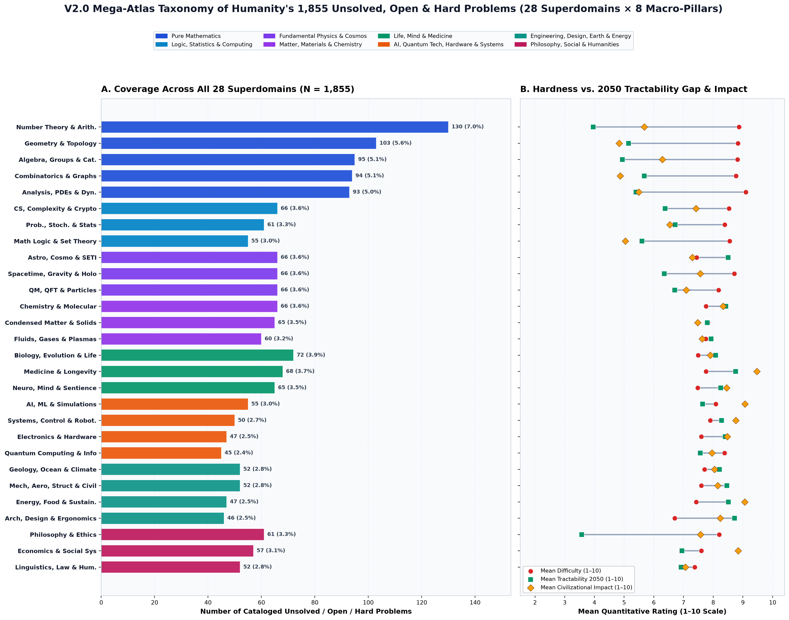
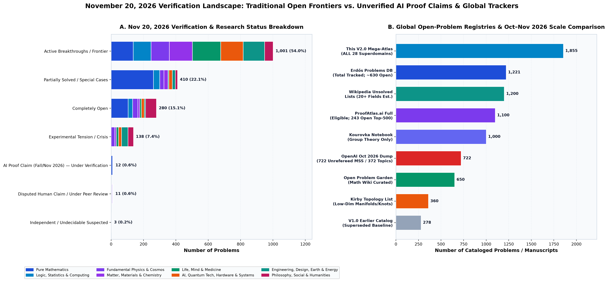

# Unsolved Problems Mega-Atlas (V2.0 · November 20, 2026 Edition)

**Exhaustive Deep-Dive Quantitative Taxonomy, Multi-Dimensional Comparison & Contrast Atlas, Cross-Domain NetworkX Connectome, and November 2026 Verification Audit of Humanity's 1,855 Unsolved, Open & Hard Problems Across All Fields of Knowledge**

- **Author:** Alexander Stephen Donahue (`Alexander S. Donahue`) · **ORCID:** [0009-0006-8168-9648](https://orcid.org/0009-0006-8168-9648)
- **Affiliation:** 0thernes LLC, Spokane, WA, USA · [0thernes.art](https://0thernes.art) · `0_0@0thernes.art`
- **Repository:** [https://github.com/0thernes/unsolved-problems-mega-atlas](https://github.com/0thernes/unsolved-problems-mega-atlas)
- **Dual License:** MIT License (`src/`, `.github/`, `scripts/`) · CC BY 4.0 (`outputs/`, `README.md`, figures)

---

## Executive Scale & Quantitative Snapshot

| Metric | Value | Scope / Significance |
|---|---:|---|
| **Cataloged Unique Open / Hard Problems** | **1,855** | Strictly deduplicated from 1,860 raw authored entries (5 cross-field overlaps cleanly merged) |
| **Taxonomy Hierarchy** | **8 × 28 × 1,705** | 8 Macro-Pillars · 28 Superdomains · 1,705 granular subdomains |
| **Unified Knowledge-Graph Edges** | **5,597** | **34.6%** cross-superdomain (1,934) · **17.6%** cross-pillar (983) · Avg degree **6.03** |
| **Connected Components** | **1** (`1,855 / 1,855`) | Every branch of human inquiry joins into **one single connected component** (11 communities) |
| **Historical Longevity Span** | **500 BCE – 2024 CE** | Median formulation year **1979** (median open age **47 years**; max **2,526 years**) |
| **Quantitative Means (1–10)** | **D: 8.14 · T2050: 6.78 · I: 7.19** | Interdisciplinarity **7.33** · Composite Titan Index **7.30** |
| **Fall/Nov 2026 AI Proof Claims Audited** | **12** | Including Sept 8 Navier–Stokes, Oct 6 `openai/math` targets & Nov 20 Lean RH/GRH claims |
| **Comparative Reference Tables** | **13 + 15 + 20** | 13 Global Open-Problem Registries · 15 Iconic Pairwise Contrasts · 20 Resolved Benchmarks (1995–2026) |

---

## Complete Multi-Format Deliverables (`outputs/`)

| Format | File | Description |
|---|---|---|
| **Offline Interactive HTML App** | [`outputs/MegaAtlas_Interactive_Dashboard_V2.html`](outputs/MegaAtlas_Interactive_Dashboard_V2.html) | Self-contained offline web app: instant search across all 1,855 problems, 7 cascading facet filters (including **Nov 2026 AI Claims**), paginated sortable table, detail modals with clickable graph neighbors, **Live Any-2-Problems Comparator**, **12-Chart Lightbox Gallery**, **Nov 2026 AI Audit & Global Registries**, **All Matrices**, Dark/Light toggle. |
| **Vector Monograph (PDF)** | [`outputs/MegaAtlas_Comprehensive_Report_V2.pdf`](outputs/MegaAtlas_Comprehensive_Report_V2.pdf) | Print-ready vector monograph with executive cover, Nov 20 2026 AI Verification Special Report, Global Registries table, all 12 high-res charts, comparison matrices, Top 40 Keystone hubs, 15 contrasts, 20 resolved benchmarks, and complete 1,855-problem directory. |
| **Excel Workbook (XLSX)** | [`outputs/MegaAtlas_Unsolved_Problems_V2.xlsx`](outputs/MegaAtlas_Unsolved_Problems_V2.xlsx) | **13 styled sheets** with live Excel formulas (`COUNTA`, `AVERAGE`, `MEDIAN`, `COUNTIF`, `AVERAGEIF`), heat-map conditional scales, frozen panes, auto-filters, and embedded native openpyxl charts. |
| **Legacy Excel (XLS)** | [`outputs/MegaAtlas_Unsolved_Problems_V2_Legacy.xls`](outputs/MegaAtlas_Unsolved_Problems_V2_Legacy.xls) | Genuine Excel 97–2003 BIFF `.xls` workbook (8 sheets). |
| **Master CSV** | [`outputs/MegaAtlas_Unsolved_Problems_V2.csv`](outputs/MegaAtlas_Unsolved_Problems_V2.csv) | UTF-8 BOM RFC4180 table (1,855 rows × 38 columns including NetworkX PageRank, degree, betweenness & Titan Index). |
| **Master TSV** | [`outputs/MegaAtlas_Unsolved_Problems_V2.tsv`](outputs/MegaAtlas_Unsolved_Problems_V2.tsv) | Tab-separated table for CLI/R/Python pipelines. |
| **Structured JSON** | [`outputs/MegaAtlas_Unsolved_Problems_V2.json`](outputs/MegaAtlas_Unsolved_Problems_V2.json) | Complete nested JSON with all 1,855 problems, 5,597 graph edges, registries, AI audit ledger, matrices, contrasts & benchmarks. |
| **Markdown Encyclopedia (MD)** | [`outputs/MegaAtlas_Unsolved_Problems_V2.md`](outputs/MegaAtlas_Unsolved_Problems_V2.md) | Exhaustive GFM reference with Mermaid taxonomy flowchart, all matrices, embedded charts, and complete 1,855-problem catalog. |
| **Plain Text Reference (TXT)** | [`outputs/MegaAtlas_Unsolved_Problems_V2.txt`](outputs/MegaAtlas_Unsolved_Problems_V2.txt) | Fixed-width ASCII reference with box tables, histograms, matrices, audit ledger, and all 1,855 problems. |
| **12 Publication Charts** | [`outputs/charts/`](outputs/charts/) | 24 standalone figures (220-DPI `.png` + infinite-zoom vector `.svg`). |
| **Cryptographic Integrity** | [`CHECKSUMS.sha256`](CHECKSUMS.sha256) | Full SHA-256 manifest verified automatically on every push via GitHub Actions CI. |

---

## Eight Macro-Pillars Comparative Scorecard

| Macro-Pillar | Problems | Share | Mean Diff | Mean Tract 2050 | Mean Impact | Nov 2026 AI Claims |
|---|---:|---:|---:|---:|---:|---:|
| **Pure Mathematics** (NT, Algebra, Geom/Topo, Analysis/PDEs, Comb) | 515 | 27.8% | 8.88 | 4.95 | 5.44 | 9 |
| **Life, Mind & Medicine** (Bio/Evo, Neuro/Consciousness, Medicine) | 205 | 11.1% | 7.58 | 8.36 | 8.60 | 0 |
| **Fundamental Physics & Cosmos** (QM/QFT, Spacetime/QG, Astro/Cosmo) | 198 | 10.7% | 8.11 | 7.18 | 7.32 | 1 |
| **AI, Quantum Tech, Hardware & Systems** (AI/Sim, QC, Elec, Control/Rob) | 197 | 10.6% | 7.99 | 7.96 | 8.59 | 0 |
| **Engineering, Design, Earth & Energy** (Mech/Civil, Arch/Ergo, Geo, Energy) | 197 | 10.6% | 7.38 | 8.47 | 8.36 | 0 |
| **Matter, Materials & Chemistry** (Condensed Matter, Fluids/Plasmas, Chem) | 191 | 10.3% | 7.77 | 8.06 | 7.82 | 0 |
| **Logic, Statistics & Computing** (Logic/Set, Prob/Stats, CS/Crypto/Info) | 182 | 9.8% | 8.49 | 6.26 | 6.41 | 2 |
| **Philosophy, Social & Humanities** (Phil/Ethics, Econ/Game, Ling/Hist/Law) | 170 | 9.2% | 7.75 | 5.73 | 7.84 | 0 |
| **TOTAL / GLOBAL MEAN** | **1,855** | **100.0%** | **8.14** | **6.78** | **7.19** | **12** |

---

## Visual Analytics Highlights





---

## Honest Verification Boundaries & AI-Assistance Disclosure

- **Epistemic Scope:** Quantitative ratings (`difficulty_score`, `tractability_2050`, `civilizational_impact`, `interdisciplinarity_index`) are structured rubric estimates intended for cross-domain comparative analysis—not peer-reviewed consensus forecasts.
- **November 20, 2026 AI Proof-Claim Discipline:** Problems targeted by Fall–November 2026 AI proof claims—including OpenAI's Sept 8, 2026 Navier–Stokes claim, OpenAI's Oct 6, 2026 `openai/math` bulk release (722 manuscripts across 372 topics), and the Nov 20, 2026 Levent Alpöge / Anthropic Claude multi-million-line Lean 4 Riemann Hypothesis & GRH claim (alongside Alessandro Masullo's human draft)—are explicitly flagged `"AI Proof Claim (Fall/Nov 2026) — Under Verification"` and remain treated as **officially unresolved** pending formal-statement fidelity auditing and independent mathematical community consensus.
- **Transparency Disclosure:** This dataset, Python analytics pipeline, chart suite, and multi-format export engine were compiled and audited with AI-assisted research tooling, validated programmatically via strict schema assertions, cross-module deduplication, NetworkX graph verification, and SHA-256 cryptographic checksums checked in GitHub Actions CI.

## Reproducing Locally

```bash
python -m venv .venv
.venv/Scripts/pip install pandas numpy scipy matplotlib seaborn networkx openpyxl xlwt pillow
python src/v2_loader.py
python src/v2_charts.py
python src/v2_export_all.py
```
