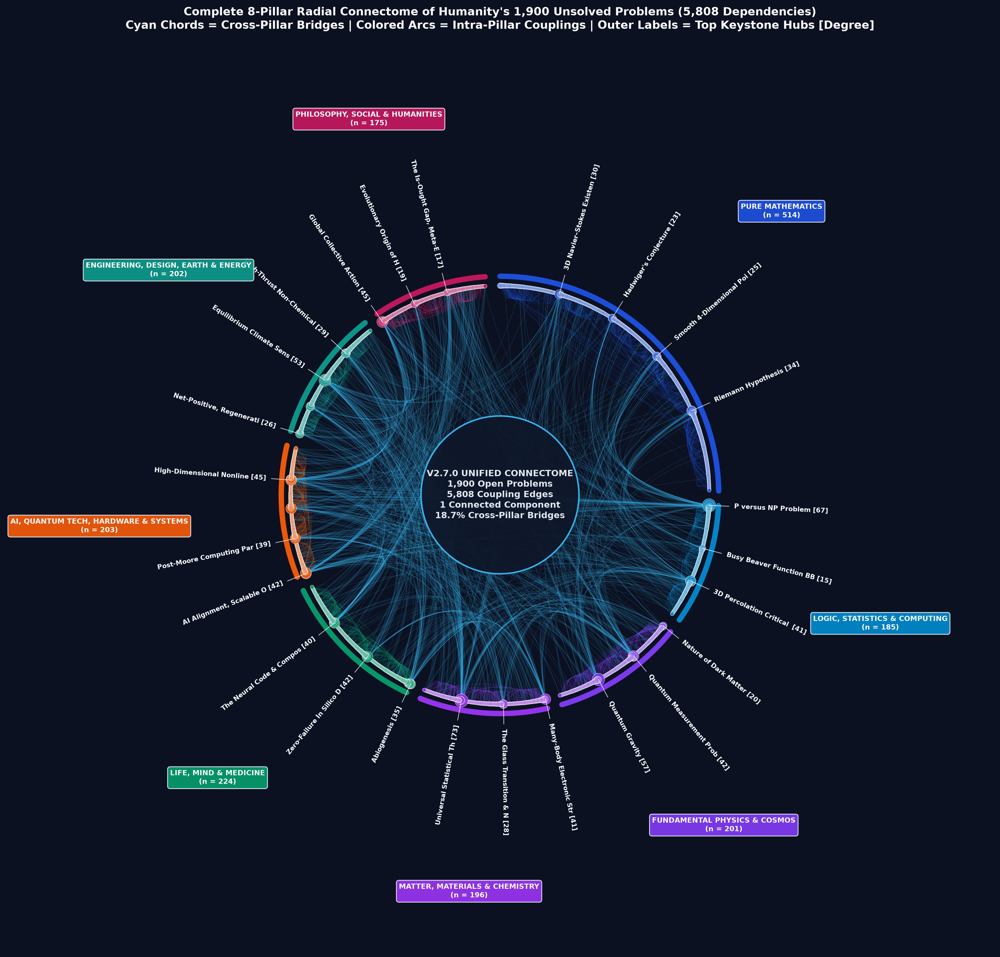

# Unsolved Problems Mega-Atlas (`v2.2.0`)

[](https://github.com/0thernes/unsolved-problems-mega-atlas/actions/workflows/ci.yml)
[](https://0thernes.github.io/unsolved-problems-mega-atlas/)
[](lean/MegaAtlasProofs/VerifyAxioms.lean)
[](https://orcid.org/0009-0006-8168-9648)
[](croissant.json)
[](NOTICE)

> **1,855 rigorously deduplicated unsolved, open, and hard problems across ALL 8 Macro-Pillars × 28 Superdomains of human knowledge** — wired into **1 connected 5,597-edge knowledge graph**, ranked by the **0thernes Composite Severity Score (`CSS`)** and **Composite Titan Index**, paired with a **live November 20, 2026 AI Proof-Claim Verification Audit**, an **offline Hybrid BM25+Graph RAG CLI (`96.0% MRR@5`) & 7-tool MCP stdio server**, a **Karpathy-style AutoResearch harness (`autoresearch/`)**, **FAIR Croissant 1.0 / RO-Crate 1.1 / Zenodo metadata**, **12 publication-grade charts**, **12 export formats**, and **58 Pure Lean 4.35.0 machine-checked formal invariants**.

- **Live Interactive Web Atlas:** [https://0thernes.github.io/unsolved-problems-mega-atlas/](https://0thernes.github.io/unsolved-problems-mega-atlas/) *(also serves [`llms.txt`](https://0thernes.github.io/unsolved-problems-mega-atlas/llms.txt), [`croissant.json`](https://0thernes.github.io/unsolved-problems-mega-atlas/croissant.json) & [`ro-crate-metadata.json`](https://0thernes.github.io/unsolved-problems-mega-atlas/ro-crate-metadata.json))*
- **Author / Curator (Human-in-the-Loop):** **Alexander Stephen Donahue** (`0thernes LLC`, Spokane, WA, USA · ORCID [`0009-0006-8168-9648`](https://orcid.org/0009-0006-8168-9648) · [0thernes.art](https://0thernes.art))
- **Master Research Archive Entry:** `0TH-BUILD-007` in [`0thernes/0thernes-research-archive`](https://github.com/0thernes/0thernes-research-archive)
- **Companion Deep-Dive Math Atlas:** [`0thernes/unsolved-mathematics`](https://github.com/0thernes/unsolved-mathematics) *(shares the exact 0thernes `CSS` ranking standard)*

---

## Epistemic Honesty & Verification Boundary (Read First)

> **Solo Human + Disclosed AI-Assisted Research Infrastructure:** This atlas is architected, directed, audited, and published by solo researcher **Alexander Stephen Donahue** with disclosed frontier AI assistance (see [`AUTHORS.md`](AUTHORS.md), [`docs/AI_DISCLOSURE.md`](docs/AI_DISCLOSURE.md), and [`docs/DATASHEET.md`](docs/DATASHEET.md)).
> - **What IS machine-verified:** All **58 Pure Lean 4.35.0 theorems** (`lean/MegaAtlasProofs/`, 7 modules, 817 lines, zero Mathlib, zero `sorry`, zero `native_decide`, axioms strictly within `[propext, Quot.sound]` or empty) certifying exact scoring, quadrant, era, taxonomy, finite graph handshaking, pairwise delta antisymmetry, and Karpathy AutoResearch anti-gaming keep/discard invariants; JSON Schema Draft 2020-12 compliance on all `1,855` records; 19-test `pytest` suite (including live MCP stdio JSON-RPC & FAIR SHA-256 parity); and byte-exact SHA-256 digests (`CHECKSUMS.sha256`).
> - **What is NOT claimed:** This repository makes **zero claim to solve any open problem**. Quantitative rubric scores (`difficulty`, `tractability_2050`, `impact`, `interdisciplinarity`, `CSS`, `Titan Index`) are **transparent, falsifiable editorial estimates** — not peer-reviewed measurements. Every record carries an explicit `verification_flag`, and **all 12 Fall/Nov 2026 AI proof claims remain officially unretired** pending independent fidelity auditing and peer consensus.

---

## November 20, 2026 AI Proof-Claim Verification Advisory

Active mathematical registries already track well over 1,100–2,000+ open problems (`ProofAtlas.ai`: 1,100+ eligible / 243 open in Top-500; `erdosproblems.com`: ~1,221 tracked / ~630+ open; Kourovka: >1,000; Kirby: >360). Fall–November 2026 saw dramatic AI proof claims—including OpenAI's Sept 8 **3D Navier–Stokes** blowup claim (`ANL-001`), OpenAI's Oct 6 **722-manuscript bulk release** across 372 topics, and the Nov 20 **Levent Alpöge / Claude multi-million-line Lean 4 Riemann Hypothesis & GRH archive** (`NT-001`, `NT-002`) alongside Stanford's **Alessandro Masullo** human draft. Because Lean kernel compilation checks logical deduction *rather than formalization statement fidelity or community consensus*, **all 12 AI-claimed problems are strictly retained as OPEN under `verification_flag = "ai-claim-under-audit-nov2026"`**.

---

## Key Metrics & Eight Macro-Pillars (`N = 1,855`)

| Macro-Pillar | Problems | Share | Superdomains | Mean CSS (0–100) | Mean Titan (0–10) | Mean Diff | Mean Tract (2050) | Mean Impact | Nov 2026 AI Claims |
|---|---:|---:|---:|---:|---:|---:|---:|---:|---:|
| **Pure Mathematics** | 515 | 27.8% | 5 | 59.82 | 6.53 | 8.88 | 4.95 | 5.44 | 9 |
| **Life, Mind & Medicine** | 205 | 11.1% | 3 | 55.93 | 7.83 | 7.58 | 8.36 | 8.60 | 0 |
| **Fundamental Physics & Cosmos** | 198 | 10.7% | 3 | 56.44 | 7.39 | 8.11 | 7.18 | 7.32 | 1 |
| **AI, Quantum Tech, Hardware & Systems** | 197 | 10.6% | 4 | 55.55 | 7.93 | 7.99 | 7.96 | 8.59 | 0 |
| **Engineering, Design, Earth & Energy** | 197 | 10.6% | 4 | 54.50 | 7.67 | 7.38 | 8.47 | 8.36 | 0 |
| **Matter, Materials & Chemistry** | 191 | 10.3% | 3 | 55.43 | 7.51 | 7.77 | 8.06 | 7.82 | 0 |
| **Logic, Statistics & Computing** | 182 | 9.8% | 3 | 57.27 | 7.07 | 8.49 | 6.26 | 6.41 | 2 |
| **Philosophy, Social & Humanities** | 170 | 9.2% | 3 | 59.90 | 7.71 | 7.75 | 5.73 | 7.84 | 0 |
| **Unified Mega-Atlas Total / Mean** | **1,855** | **100.0%** | **28** | **57.32** | **7.30** | **8.14** | **6.78** | **7.19** | **12** |

- **Connectome:** **5,597 undirected coupling edges** · **1 single connected component** (`1,855/1,855`) · **34.6%** cross-superdomain (`1,934`) · **17.6%** cross-pillar (`983`) · **11** modularity communities · average degree `6.03`.
- **Epistemic Flags:** `primary-registry-indexed` (`687`) · `ai-assisted-editorial-synthesis` (`1,145`) · `ai-claim-under-audit-nov2026` (`12`) · `disputed-human-claim` (`11`).
- **Top Keystone Domino Hubs:** `FLD-001` Fluid Turbulence (`deg=71`, `51` XP) · `CS-001` P vs. NP (`deg=62`, `40` XP) · `GR-001` Quantum Gravity (`deg=53`, `23` XP) · `GEO-002` Climate Sensitivity (`deg=50`, `29` XP) · `STAT-001` 3D Percolation (`deg=39`, `31` XP).




---

## Export Formats & Institutional Artifacts

| Artifact | Path | Purpose |
|---|---|---|
| **Interactive Web Atlas** | [`outputs/MegaAtlas_Interactive_Dashboard_V2.html`](outputs/MegaAtlas_Interactive_Dashboard_V2.html) | Offline standalone web app (also live on [GitHub Pages](https://0thernes.github.io/unsolved-problems-mega-atlas/)): paginated 1,855-row catalog, 7 filters, CSS/Titan sort, Any-2 Comparator, Nov 2026 AI Audit & 12-chart zoom |
| **Vector PDF Monograph** | [`outputs/MegaAtlas_Comprehensive_Report_V2.pdf`](outputs/MegaAtlas_Comprehensive_Report_V2.pdf) | Complete ~163-page publication monograph with cover, matrices, 12 embedded figures, contrasts & full 1,855-problem directory |
| **Build White Paper** | [`docs/WHITE_PAPER.md`](docs/WHITE_PAPER.md) | Concise institutional white paper archived in `0thernes-research-archive` (`0TH-BUILD-007`) |
| **Master Ranking** | [`RANKING.md`](RANKING.md) | Auto-generated Top 250 overall by `0thernes CSS`, 8 Macro-Pillar leaders & Nov 2026 AI watchlist |
| **SQLite 3 + FTS5 DB** | [`outputs/MegaAtlas_Unsolved_Problems_V2.sqlite`](outputs/MegaAtlas_Unsolved_Problems_V2.sqlite) | 9 normalized tables + Porter-stemmed FTS5 full-text search index powering `rag/query.py` |
| **Excel Workbooks** | [`MegaAtlas_Unsolved_Problems_V2.xlsx`](outputs/MegaAtlas_Unsolved_Problems_V2.xlsx) · [`_Legacy.xls`](outputs/MegaAtlas_Unsolved_Problems_V2_Legacy.xls) | 13-sheet live-formula XLSX (`COUNTIF`, `AVERAGEIF`, conditional color scales, native charts) + 8-sheet BIFF `.xls` |
| **Tabular & Streaming** | [`.csv`](outputs/MegaAtlas_Unsolved_Problems_V2.csv) · [`.tsv`](outputs/MegaAtlas_Unsolved_Problems_V2.tsv) · [`.json`](outputs/MegaAtlas_Unsolved_Problems_V2.json) · [`.jsonl`](outputs/MegaAtlas_Unsolved_Problems_V2.jsonl) | 1,855 × 40 UTF-8 datasets & streaming JSONL validated against [`schema/problem.schema.json`](schema/problem.schema.json) |
| **Markdown & Plain Text** | [`.md`](outputs/MegaAtlas_Unsolved_Problems_V2.md) · [`.txt`](outputs/MegaAtlas_Unsolved_Problems_V2.txt) | Full text/Mermaid mega-atlas and fixed-width ASCII reference |
| **12 Vector + Raster Charts** | [`outputs/charts/`](outputs/charts/) | 12 figures × 2 formats (`220 DPI PNG` + `Vector SVG` = 24 files) |
| **Pure Lean 4.35.0 Suite** | [`lean/MegaAtlasProofs/`](lean/MegaAtlasProofs/) | 7 modules, 817 lines, **58 audited theorems**, 0 `sorry`, `[propext, Quot.sound]` |
| **Karpathy AutoResearch** | [`autoresearch/program.md`](autoresearch/program.md) · [`evaluate.py`](autoresearch/evaluate.py) · [`results.tsv`](autoresearch/results.tsv) | Autonomous research loop, immutable 5-axis AQS + 25-query RAG oracle, Planner–Worker–Verifier [`whiteboard.md`](autoresearch/whiteboard.md) & [`OSS_STACK.md`](autoresearch/OSS_STACK.md) |
| **MCP Stdio Server** | [`mcp_server/server.py`](mcp_server/server.py) · [`mcp_server/README.md`](mcp_server/README.md) | Zero-dependency JSON-RPC 2.0 server exposing 7 live tools to Claude Code, Antigravity, Cursor & Gemini CLI |
| **FAIR & AI Discovery** | [`.zenodo.json`](.zenodo.json) · [`croissant.json`](croissant.json) · [`ro-crate-metadata.json`](ro-crate-metadata.json) · [`docs/DATASHEET.md`](docs/DATASHEET.md) | Zenodo Auto-DOI, MLCommons Croissant 1.0, W3C RO-Crate 1.1, Gebru Datasheet, [`AGENTS.md`](AGENTS.md), [`llms.txt`](llms.txt) & [`SECURITY.md`](SECURITY.md) |
| **Governance & Integrity** | [`VERIFICATION.md`](VERIFICATION.md) · [`EVIDENCE.md`](EVIDENCE.md) · [`PHILOSOPHY.md`](PHILOSOPHY.md) · [`ARCHITECTURE.md`](ARCHITECTURE.md) · [`CHECKSUMS.sha256`](CHECKSUMS.sha256) | Complete epistemic boundaries, cryptographic hashes & academic review protocols |

---

## Quickstart: Offline RAG, MCP Server, AutoResearch & Full Rebuild

```bash
# Install Python dependencies
pip install -r requirements.txt

# 1. Query the zero-API Hybrid BM25 + Graph-Authority RAG CLI (96.0% MRR@5, <30 ms)
python rag/query.py "turbulence climate sensitivity" --top 6 --hops 1
python rag/query.py --compare NT-001 CS-001
python rag/query.py --flag ai-claim-under-audit-nov2026 --top 20

# 2. Launch the 7-tool Model Context Protocol (MCP) stdio server for AI agents
python mcp_server/server.py

# 3. Run the immutable Karpathy-style AutoResearch evaluation oracle
python autoresearch/evaluate.py --verify-gates

# 4. Verify all 58 Pure Lean 4.35.0 formal invariants & print axioms
cd lean && lake build && cd ..

# 5. Run the full automated pytest suite & cryptographic SHA-256 auditor
pytest -v
python scripts/audit_atlas.py --check-lean
```

To rebuild every chart, dataset, SQLite DB, `RANKING.md`, FAIR metadata, HTML, PDF, Lean proof, and SHA-256 checksum from scratch:
- **Windows PowerShell:** `.\build.ps1`
- **Unix / macOS / WSL:** `make all`

---

## Citation & Dual Licensing

- **Data, Taxonomy, Prose, Charts & PDFs:** Creative Commons Attribution 4.0 International ([`LICENSE`](LICENSE)).
- **Code, Schemas, RAG/MCP, AutoResearch, Tests, CI & Lean 4 Proofs:** MIT License ([`LICENSE-CODE`](LICENSE-CODE)). See [`NOTICE`](NOTICE), [`CITATION.cff`](CITATION.cff), and [`CITATION.bib`](CITATION.bib).

```bibtex
@dataset{donahue2026megaatlas,
  author       = {Donahue, Alexander Stephen},
  title        = {Unsolved Problems Mega-Atlas (V2.2.0): Cross-Disciplinary Taxonomy,
                  0thernes CSS Ranking, 1,855-Node Connectome, Offline FTS5 RAG \& MCP Server,
                  Karpathy-Style AutoResearch Harness, Nov 2026 AI Proof-Claim Audit,
                  and Pure Lean 4.35.0 Formal Invariants},
  year         = {2026},
  month        = nov,
  publisher    = {0thernes LLC},
  version      = {2.2.0},
  url          = {https://github.com/0thernes/unsolved-problems-mega-atlas},
  note         = {ORCID: 0009-0006-8168-9648; Master Archive: 0TH-BUILD-007}
}
```
